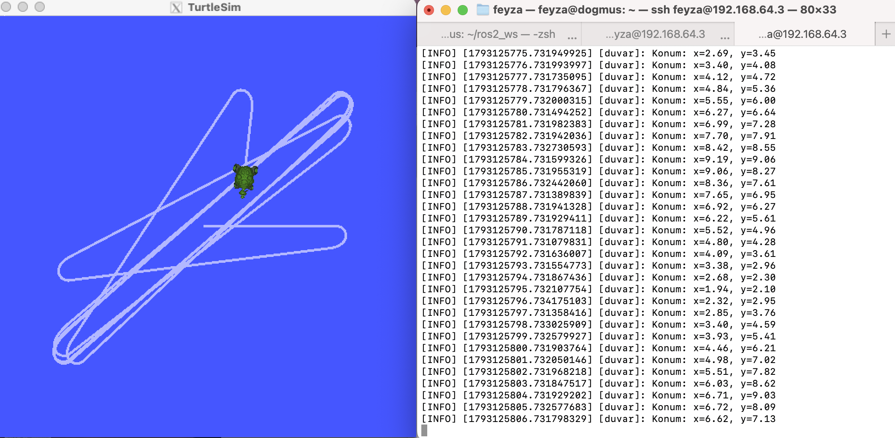

# turtle_duvar_py

ROS 2 Humble ile "Duvardan Kaçan Kaplumbağa" ödevi.

## Ne yapar
- `/turtle1/pose` konusunu dinler
- `/turtle1/cmd_vel` konusuna hız komutu yayınlar
- x veya y değeri alt sınırın altına ya da üst sınırın üstüne çıkarsa kaplumbağa arena merkezine doğru döner
- Konumu saniyede bir loglar

## Parametreler (bonus)
| Parametre | Varsayılan | Açıklama |
|-----------|-----------|----------|
| hiz | 1.5 | İleri hız |
| alt_sinir | 1.0 | Alt sınır |
| ust_sinir | 10.0 | Üst sınır |
| donus_hizi | 3.0 | Maksimum dönüş hızı |

## Çalıştırma
    colcon build --packages-select turtle_duvar_py
    source install/setup.bash
    ros2 run turtlesim turtlesim_node
    ros2 run turtle_duvar_py duvar

Parametrelerle:

    ros2 run turtle_duvar_py duvar --ros-args -p hiz:=1.0 -p alt_sinir:=2.0 -p ust_sinir:=9.0 -p donus_hizi:=4.0

## Not
Varsayılan sınırlarla (1.0 ve 10.0) kaplumbağa duvara çarptığı için testlerde 2.0 ve 9.0 sınırları kullanıldı.

## Ekran görüntüsü

